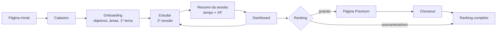
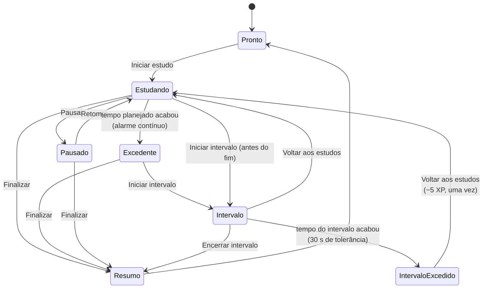
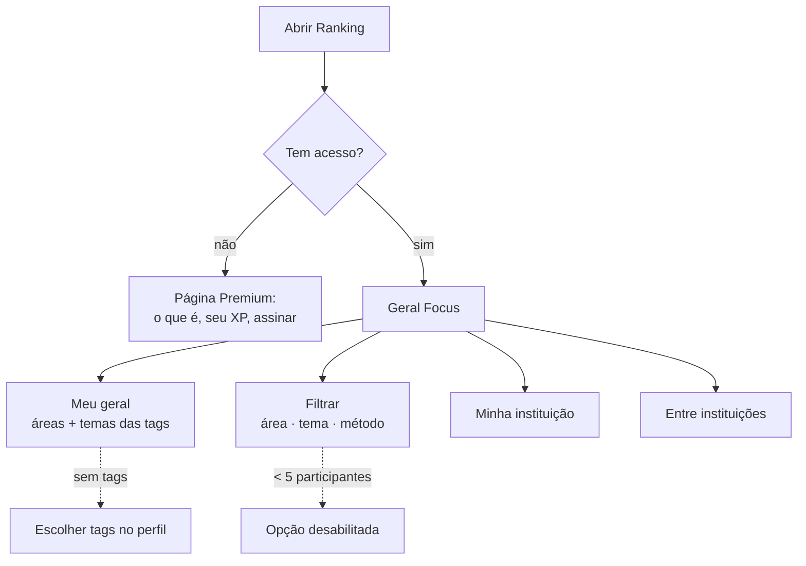
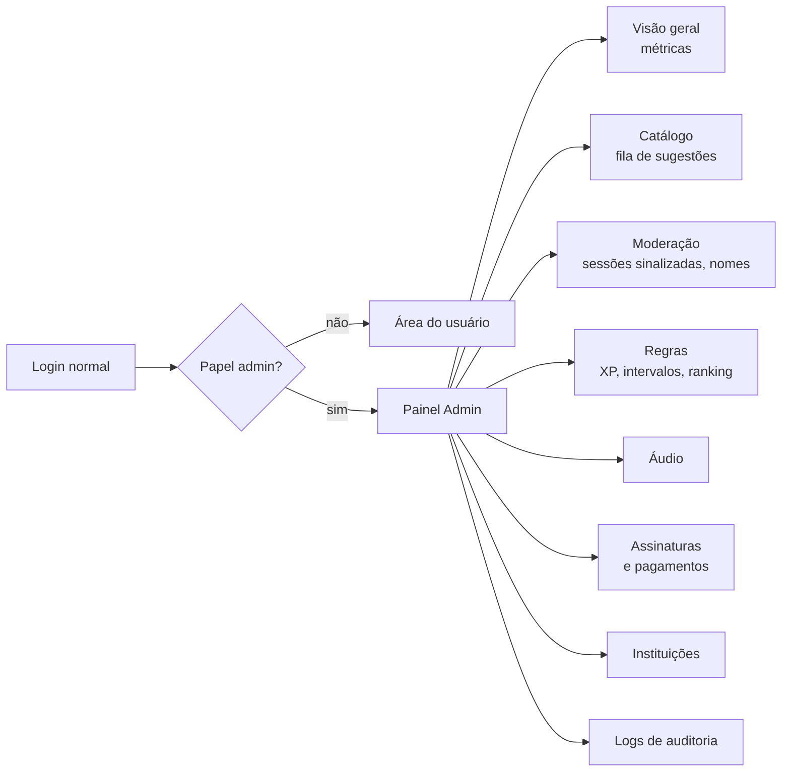
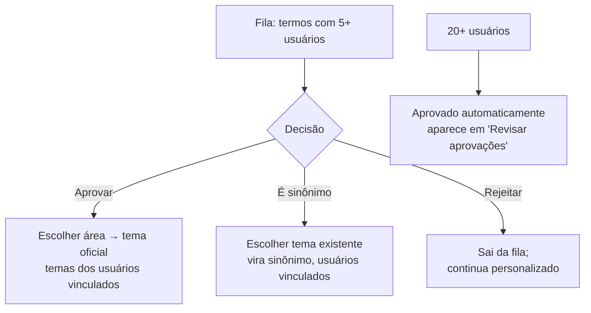

# Focus — Userflow ideal

Legenda: ✅ implementado · 🟡 parcial · ⏳ planejado

---

## Parte A — Usuário

### Visão geral

O núcleo do produto é o **loop diário**: abrir → estudar → ver progresso → voltar amanhã. Todo o resto (ranking, tags, assinatura) existe para alimentar esse loop.

### A1. Descoberta e cadastro

| # | Passo | O que o usuário vê/faz | Status |
|---|---|---|---|
| 1 | Página inicial | Proposta ("Foque no que importa. Evolua todo dia."), Começar grátis / Entrar | ✅ |
| 2 | Cadastro | Nome de exibição (público), e-mail (privado), senha | ✅ |
| 3 | Confirmação de e-mail | Link de confirmação; sem confirmar, pode estudar mas não entra no ranking | ⏳ |
| 4 | Fuso horário | Detectado automaticamente pelo navegador, editável no perfil | 🟡 (padrão São Paulo, editável) |
| 5 | Código Focus | Cada conta recebe um código público único (ex.: FCS-7K2Q9XMP) | ✅ |
| 6 | "Você estuda em alguma instituição?" | Etapa de boas-vindas: CPF + instituição (base e-MEC/INEP) + matrícula — opcional | ✅ (base nacional ⏳ importação) |

### A2. Onboarding (primeiros 2 minutos)

Objetivo: **a primeira sessão começa em menos de 2 minutos**.

| # | Passo | Detalhe | Status |
|---|---|---|---|
| 1 | "Para que você estuda?" | Objetivos (ENEM, Concurso, Certificação…) — até 3 | 🟡 (existe no perfil, não no onboarding) |
| 2 | Áreas e temas de interesse | Sugestões do catálogo conforme o objetivo | 🟡 (existe no perfil) |
| 3 | Primeira categoria e tema | Trilha pronta ("CCNA – Introduction to Networks") ou criação manual com sugestões do catálogo | 🟡 (criação manual ✅, trilhas ⏳) |
| 4 | Escolha do método | Pomodoro clássico pré-selecionado; explicação de 1 linha de cada | ✅ (na tela Estudar) |
| 5 | Teste do alarme | "Toque para testar o som" (também desbloqueia o áudio no navegador) | 🟡 (botão existe, não no onboarding) |
| 6 | Iniciar primeira sessão | Leva direto ao cronômetro rodando | ⏳ (hoje o cadastro leva para Categorias) |

### A3. Loop de estudo (núcleo)

| # | Passo | Detalhe | Status |
|---|---|---|---|
| 1 | Abrir "Estudar" | Último tema e método já selecionados | ✅ |
| 2 | Iniciar | Um clique; cliques repetidos não duplicam | ✅ |
| 3 | Foco | Contagem regressiva grande, estado visível, título da aba com o tempo | ✅ |
| 4 | Modo foco | Tela cheia, aviso discreto ao sair da aba, sons ambientes | ⏳ |
| 5 | Pausa | Tempo parado não conta como estudo; registrado à parte | ✅ |
| 6 | Fim do tempo | Alarme MP3 contínuo + "Silenciar"; excedente contando para cima | ✅ |
| 7 | Intervalo | Duração do método (longo a cada 4 ciclos no Pomodoro); excedente + penalidade única | ✅ |
| 8 | Voltar aos estudos | Encerra intervalo e inicia o próximo ciclo no mesmo tema | ✅ |
| 9 | Resumo da sessão | Tempo estudado, excedente, pausa, XP ganho | ✅ |
| 10 | Reflexão rápida | Nota de foco 1–5 + anotação opcional | ⏳ |
| 11 | Notificação do sistema | Aviso do navegador quando o tempo acaba com a aba em segundo plano | ⏳ |

**Situações de exceção (todas tratadas no servidor):**

| Situação | Comportamento | Status |
|---|---|---|
| Atualizou a página | Sessão continua de onde estava (tempo vem do servidor) | ✅ |
| Abriu em outro dispositivo | Mesma sessão aparece lá | ✅ |
| Fechou o navegador | Sem sinal por 10 min → sessão encerrada no último sinal; tempo até ali conta | ✅ |
| Pausa esquecida | Encerrada após 12 h, no momento da pausa | ✅ |
| Intervalo esquecido | Encerrado após planejado + 2 h; penalidade aplicada uma vez | ✅ |
| Sessão muito longa (> 6 h) | Sinalizada para revisão do admin, sem descartar | ✅ (revisão no painel ⏳) |
| Sem internet | Cronômetro continua na tela; ações reenviadas ao reconectar | 🟡 (mostra erro e permite tentar de novo) |

### A4. Organização

| # | Passo | Status |
|---|---|---|
| 1 | Criar categoria com área do conhecimento | ✅ |
| 2 | Criar tema com sugestão do catálogo (vínculo automático se o nome existir) | ✅ |
| 3 | Vincular tema personalizado ao catálogo | ✅ |
| 4 | Renomear, mudar cor, arquivar, restaurar, excluir (histórico preservado) | ✅ |
| 5 | Importar trilha pronta | ⏳ |

### A5. Acompanhamento

| # | Passo | Status |
|---|---|---|
| 1 | Dashboard: hoje, semana, mês, total, XP, ciclos, sequência, posição no ranking | ✅ |
| 2 | Sessão em andamento aparece ao vivo no dashboard | ✅ |
| 3 | Filtros de período e gráficos por dia, categoria e tema | ✅ |
| 4 | Histórico de sessões e de XP | ✅ |
| 5 | Metas diárias/semanais com saldo acumulado | ⏳ |
| 6 | Medalhas diárias e conquistas | ⏳ |
| 7 | Mapa de produtividade por horário | ⏳ |
| 8 | Lembrete de revisão ("não estuda Sub-redes há 9 dias") | ⏳ |
| 9 | Resumo semanal por e-mail | ⏳ |

### A6. Competição

| # | Passo | Status |
|---|---|---|
| 1 | Geral Focus (semana / mês / sempre) | ✅ |
| 2 | Meu geral (soma das tags) | ✅ |
| 3 | Filtros combináveis com mínimo de 5 participantes | ✅ |
| 4 | Variação da posição em 24 h; sua linha fixa no fim | ✅ |
| 5 | Entrar no ranking da instituição: CPF (uma conta por CPF, guardado só como HMAC) + matrícula (única por instituição); troca a cada 90 dias; só conta o XP ganho após entrar | ✅ |
| 6 | Ranking dentro da instituição e entre instituições (média por aluno ativo, mín. 10; faculdades e escolas separadas) | ✅ (base nacional ⏳) |
| 7 | Ligas semanais por divisão, grupos privados com convite | ⏳ |
| 8 | Perfil público (nome, tags, posição) | ⏳ |

### A7. Assinatura

| # | Passo | Status |
|---|---|---|
| 1 | Página Premium → escolher plano (mensal/anual) | 🟡 (página existe, sem compra) |
| 2 | Checkout do Stripe (cartão; Pix/boleto se disponível) | ⏳ |
| 3 | Confirmação → acesso liberado assim que o webhook confirma | ⏳ (regra de acesso ✅) |
| 4 | "Minha assinatura": próxima cobrança, forma de pagamento, recibos | ⏳ |
| 5 | Cancelar → acesso até o fim do período pago | ⏳ (regra ✅) |
| 6 | Pagamento recusado → aviso, novas tentativas, acesso até o fim do período | ⏳ (regra ✅) |
| 7 | Lembretes pelo WhatsApp (premium) | ⏳ |

### A8. Conta e privacidade

| # | Passo | Status |
|---|---|---|
| 1 | Editar nome de exibição, fuso, volume do alarme | ✅ |
| 2 | Tags (áreas, temas, objetivos) | ✅ |
| 3 | Alterar senha (encerra outras sessões) / recuperar senha | ✅ |
| 4 | Exportar meus dados (LGPD) | ⏳ |
| 5 | Excluir minha conta (LGPD) | ⏳ |
| 6 | Esconder-me do ranking (participar sem aparecer) | ⏳ |

---

## Parte B — Administrador

### Visão geral

O admin usa a mesma conta para estudar; o papel `admin` (concedido só por linha de comando) libera o painel e o ranking sem assinatura. Toda ação do painel gera registro de auditoria.

### B1. Acesso

| # | Passo | Status |
|---|---|---|
| 1 | Papel admin concedido por comando no servidor (`npm run admin:grant`), nunca pelo navegador | ✅ |
| 2 | Ranking completo sem assinatura | ✅ |
| 3 | Item "Admin" no menu, visível só para admins; rotas bloqueadas no servidor para os demais | ⏳ |
| 4 | Verificação em duas etapas obrigatória para admins | ⏳ |

### B2. Visão geral (primeira tela do painel)

Indicadores: usuários cadastrados e ativos (dia/semana/mês), sessões e horas estudadas, ciclos concluídos, assinantes ativos, conversão gratuito→premium, receita recorrente mensal, cancelamentos, sessões sinalizadas e sugestões pendentes (com atalho para cada fila). ⏳

### B3. Catálogo de temas (rotina semanal)

| # | Passo | Status |
|---|---|---|
| 1 | Fila de sugestões com número de usuários e área mais usada | 🟡 (regra e consulta ✅, tela ⏳) |
| 2 | Aprovar / transformar em sinônimo / rejeitar | 🟡 (regras ✅, tela ⏳) |
| 3 | Revisar temas aprovados automaticamente | ⏳ |
| 4 | Editar nome, área, mesclar temas duplicados | ⏳ |
| 5 | Gerenciar áreas (CAPES/CNPq + Preparatórios) | 🟡 (semente ✅, edição ⏳) |

### B4. Moderação

| # | Passo | Status |
|---|---|---|
| 1 | Sessões sinalizadas (> 6 h): ver detalhes (segmentos, horários) → manter ou anular o XP com motivo | 🟡 (sinalização ✅, tela ⏳) |
| 2 | Ajuste de XP manual com motivo (vira lançamento `admin_adjustment`, auditado) | 🟡 (tipo de lançamento ✅, tela ⏳) |
| 3 | Nome de exibição ofensivo → renomear e avisar | ⏳ |
| 4 | Suspender do ranking (continua estudando, não aparece) | ⏳ |
| 5 | Denúncias vindas do ranking | ⏳ |

### B5. Regras e configurações

| # | Passo | Status |
|---|---|---|
| 1 | Métodos: durações, faixa que gera XP, XP por minuto, intervalos | 🟡 (no banco ✅, tela ⏳) |
| 2 | Tolerância e penalidade de intervalo; limites de sessão abandonada | 🟡 (no banco ✅, tela ⏳) |
| 3 | Catálogo/ranking: limites de sugestão e aprovação, mínimo de participantes, limites de tags | 🟡 (no banco ✅, tela ⏳) |
| 4 | Toda mudança vale para sessões futuras e fica registrada (quem, quando, antes/depois) | 🟡 (sessões guardam regras ✅, histórico de mudanças ⏳) |

### B6. Áudio

Enviar MP3 → ouvir prévia → publicar como alarme padrão (os usuários continuam controlando o volume). 🟡 (alarme por arquivo ✅, upload ⏳)

### B7. Assinaturas e pagamentos

| # | Passo | Status |
|---|---|---|
| 1 | Lista de assinantes com status, plano, próxima cobrança | ⏳ |
| 2 | Histórico de pagamentos e eventos de webhook (para conferir divergências) | ⏳ |
| 3 | Conceder cortesia (premium manual por N dias) | 🟡 (comando ✅, tela ⏳) |
| 4 | Planos e preços (novos recursos premium entram na lista do plano) | 🟡 (tabela ✅, tela ⏳) |
| 5 | Reembolsos e disputas — feitos no painel do Stripe | ⏳ |

### B8. Instituições

| # | Passo | Status |
|---|---|---|
| 1 | Importar bases e-MEC (faculdades) e INEP (escolas) — idempotente, extintas ficam inativas | 🟡 (rotina ✅, arquivos ⏳) |
| 2 | Fila "minha instituição não está na lista" → cadastrar | 🟡 (pedidos ✅, tela ⏳) |
| 3 | Liberar CPF em disputa (remove também o vínculo institucional, auditado) | 🟡 (regra ✅, tela ⏳) |
| 4 | Mesclar instituições duplicadas; remover membros indevidos | ⏳ |

### B9. Auditoria

Lista filtrável de eventos: concessões de admin/premium, aprovações do catálogo, ajustes de XP, sessões sinalizadas e encerradas automaticamente, mudanças de regras. 🟡 (registro ✅, tela ⏳)

---

## Lacunas mais importantes (prioridade sugerida)

1. **Onboarding até a primeira sessão** — maior impacto na retenção.
2. **Painel admin: catálogo + sessões sinalizadas + regras** — o catálogo já está crescendo sozinho e precisa de moderação.
3. **Stripe** — transforma o ranking em receita.
4. **Instituições** — diferencial competitivo e canal de aquisição.
5. **LGPD: exportar e excluir conta** — obrigatório antes de abrir ao público.
6. **Confirmação de e-mail** — necessária antes de abrir o ranking ao público (evita contas falsas).
